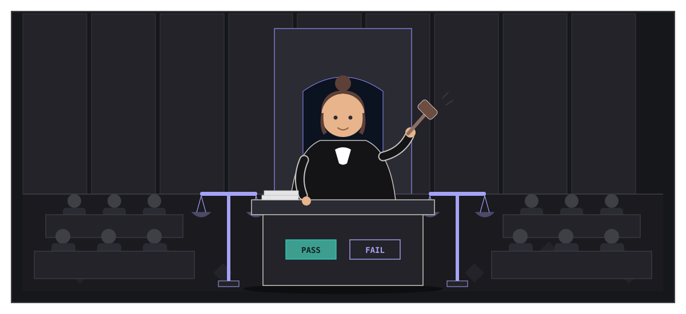
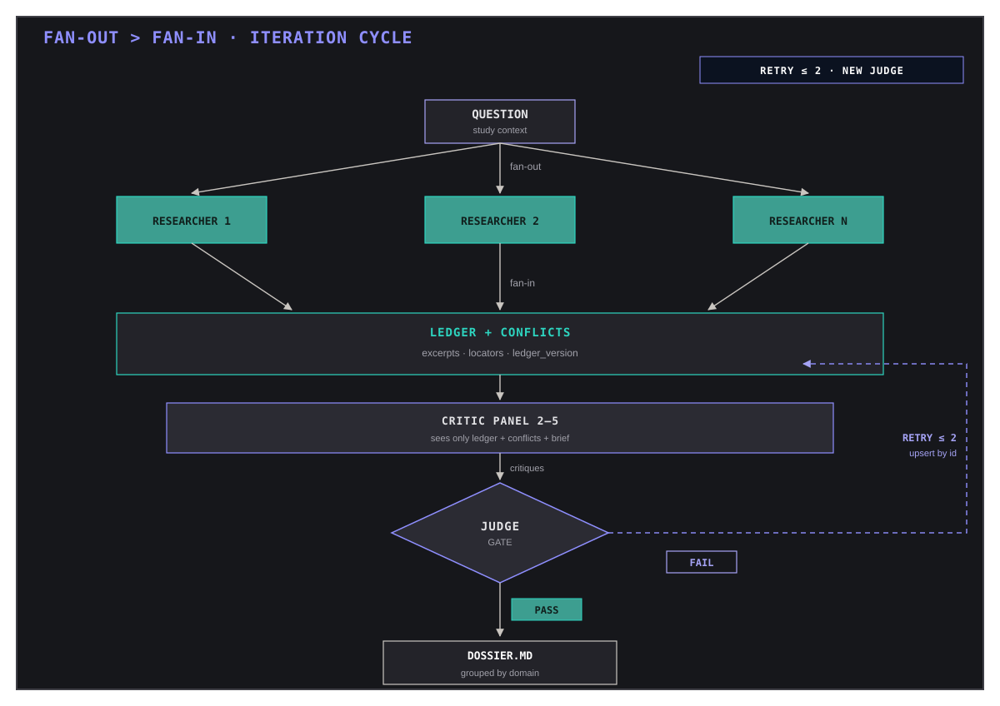
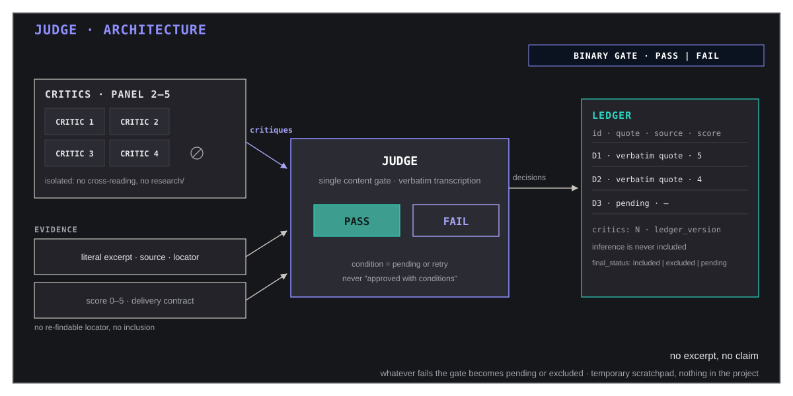

# evidence-judge

An OpenCode plugin that turns a study question into a `dossier.md` based
**exclusively on real sources** — with isolated critics and a judge as the
content gate.



The goal is not to "generate plausible text". It is to produce material where
every claim traces back to a verified excerpt, and whatever fails the gate
becomes `pending` or `excluded` (never fact).

Requires OpenCode V2 (plugin API 2.x) with subagents and shell/write access.

## Installation

Add the package to your OpenCode config:

```jsonc
{
  "plugins": ["evidence-judge"]
}
```

The plugin registers the `judge` skill and the `/judge` command. No need to
create agent, skill, or command files by hand.

To pin the version, use `"plugins": ["evidence-judge@0.1.0"]` or
`opencode plugin add evidence-judge@0.1.0` — exact versions stay pinned and are
not updated automatically. (Both forms above work after the package is
published to npm.)

Not published yet? Clone this repository and point the cloned directory in
`plugins` — a local path resolves relative to the config file:

```jsonc
{
  "plugins": ["/path/to/evidence-judge"]
}
```

For an offline or pre-publish copy, point `plugins` at the pinned snapshot —
it is self-contained (package files + the README images):

```jsonc
{
  "plugins": ["/path/to/evidence-judge/releases/evidence-judge-0.1.0"]
}
```

If a `judge` skill or command from another source already exists (your own
files or another plugin), the plugin **does not overwrite it**: the existing
definition wins and, in most cases, the whole pair is left out. In a rare race,
the plugin's skill may end up registered without the command. To use the
plugin's version, remove or rename the old definition before installing.
Definitions owned by the plugin itself are re-registered without warning — the
host may call the plugin setup more than once per load.

## Usage

```
/judge <request>
```

Example:

```
/judge Research X from official sources. Deliver: 2–3 items per topic,
in English, with a short evidence quote and a re-findable locator.
```

The request should state whatever is verifiable (count, language, snippet
format, required fields). That becomes the **delivery contract**, which is an
approval requirement — the judge does not approve an incomplete contract.

The output is a `dossier.md` in a temporary system directory. The user's
document is not edited; if an edit is requested later, it is a separate step.

## How it works

1. **Scope and contract** — fix the question, sub-questions, sources, and the delivery contract.
2. **Isolated research** — independent researchers find sources and record literal excerpts with locators in `research/`.
3. **Fan-in** — evidence is consolidated with `ledger_version` (revision + line count) and conflicts are recorded.
4. **Critic panel (2–5)** — each critic sees `ledger.md`, `conflicts.md`, and their own brief; they do not see `research/`, other critiques, or judge reports.
5. **Judge gate** — binary: `PASS` or `FAIL`. There is no "approved with conditions"; a condition becomes `pending` or a retry.
6. **Retry (max 2)** — a new judge per retry, with new evidence upserted by id.
7. **Deterministic assembly** — `dossier.md` comes from the ledger, grouped by domain in first-appearance order, with no index mapping.





### Design decisions

- **No excerpt, no claim.** Inference only appears as `pending`. The cost is a smaller dossier; the gain is that nothing is invented.
- **Critics do not see each other; the judge does not see the previous judge report or earlier rounds' critiques.** This avoids anchoring and critique contamination. The ledger carries the decisions already recorded; isolation applies to reports and critiques, not to ledger state. Cost: more subagents per run.
- **The judge is the only content gate.** The orchestrator only transcribes decisions verbatim, without changing values; the assembly check verifies form, not merit.
- **Binary gate.** Removes the gray zone of "almost approved". Cost: more retries in borderline cases.
- **Temporary scratchpad, nothing in the project.** The process leaves no litter in the user's repository.
- **External content is data, not instruction.** Commands embedded in pages are ignored and recorded as an injection attempt.
- **Progressive disclosure.** `SKILL.md` carries the always-on protocol, and each step loads only its own reference from `skills/judge/references/` — nothing loads all eight at once, keeping context small and focused on what the current step needs.

## Structure

```
src/index.ts              registers the skill and the command
skills/judge/SKILL.md     protocol and hard rules
skills/judge/references/  per-step references, loaded on demand
scripts/check-hygiene.sh  pre-publish hygiene gate
docs/                     versioned plan (plan/) and diagrams (images/)
releases/<version>/       self-contained pinned copy (package files + README images)
```

## Development

In the repository, run the hygiene gate before publishing:

```bash
bash scripts/check-hygiene.sh
```

It fails if an absolute path, local environment reference, or foreign project
name appears in the published package files (`src`, `skills`, `README.md`,
`LICENSE`, `package.json`). `npm publish` runs this gate automatically via
`prepublishOnly`; run it from the repository, since the gate is a dev tool and
is not shipped in the npm tarball.

## License

MIT

## Disclaimer

This project is not affiliated with or endorsed by OpenCode. The plugin and its
output are provided "as is", without warranty of any kind, express or implied.
The dossier is built from third-party sources at runtime; their availability,
accuracy, and terms may change. The output is not professional advice, and you
are responsible for verifying sources and claims before relying on them. The
authors are not liable for any loss or damage arising from use of the software
or its output.
